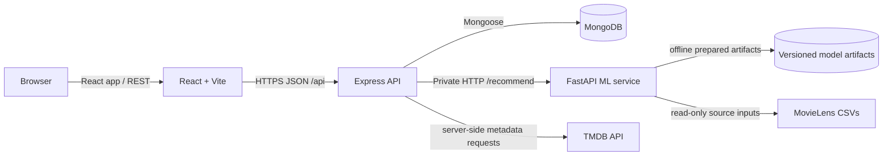

# CineMood architecture and implementation plan

## 1. Requirements specification

CineMood lets a visitor select a current mood and an optional desired post-film feeling, describe a film in natural language, and filter by available metadata. It returns ranked, explainable titles. Signed-in users can rate titles and maintain preferences, favorites, watchlists, and watched history. The ranking combines metadata relevance, mood/intent compatibility, and collaborative patterns when those signals are reliable. Explicit filters are applied as hard constraints. Cold-start requests use content and mood signals without inventing collaborative scores.

Initial scope is deliberately staged: service skeleton → catalog and baseline recommender → authentication/persistence → hybrid personalization/evaluation → product completion and deployment.

## 2. System architecture



Browser traffic terminates at Express. Express owns authentication, authorization, validation, persistence, and calls to the private ML service. The ML service owns feature/model preparation and ranking; it should not be publicly exposed in production. TMDB credentials remain on the server. MongoDB stores user-owned state and optionally a cache, not a second copy of all MovieLens ratings.

## 3. Component responsibilities

- **React/Vite:** responsive pages, mood/feeling input, search/filter controls, recommendation cards and explanations, auth state, and user library interactions. Axios calls only the Express API. Accessible labels and explicit loading/empty/error states are required.
- **Express:** REST boundary; request validation; random opaque sessions in HttpOnly cookies; scrypt password hashing; per-user authorization; trusted-Origin checks for cookie-authenticated writes; rate limits/security headers/CORS; Mongoose models; and internal FastAPI client.
- **MongoDB/Mongoose:** account and user-owned preferences, ratings/feedback, watchlist, favorites, and history. Unique compound indexes prevent duplicate user/movie actions. Every query scopes by authenticated user ID.
- **FastAPI:** separate preprocessing, feature, collaborative model, ranking, evaluation modules. MovieLens ratings are explicit 0.5–5.0 ratings (confirm observed range during ingestion). Missing user/movie cells remain missing. TF-IDF content features and sparse user-item/item-item similarity are fitted offline and serialized as versioned artifacts. New interactions can update a user preference vector immediately; full collaborative artifacts refresh in a controlled batch.

## 4. Monorepo layout

```text
.
├── frontend/                 # React + Vite browser app
│   ├── src/{components,pages,services,context,utils}/
│   ├── index.html
│   ├── package.json
│   └── .env.example
├── backend/                  # Express REST API
│   ├── src/{config,controllers,middleware,models,routes,services,validators}/
│   ├── package.json
│   └── .env.example
├── ml-service/               # FastAPI inference and offline model code
│   ├── app/{api,models,schemas,services}/
│   ├── data/                  # generated/derived data only
│   ├── artifacts/             # ignored, versioned separately
│   ├── requirements.txt
│   └── .env.example
├── docs/{architecture,api,evaluation}.md
├── movies.csv                 # local MovieLens input, gitignored
├── ratings.csv                # local MovieLens input, gitignored
└── Bollywood*.csv             # supplementary local input, gitignored
```

## 5. Data model

- **User** `_id`, `name`, normalized unique `email`, `passwordHash`, `preferredGenres[]`, `preferredLanguages[]`, timestamps.
- **Movie metadata cache** keyed by provider ID (and optional MovieLens/IMDb mapping); title, genres, overview, language, runtime, release date, provider rating, poster/backdrop paths, attribution/cache timestamps. This is cacheable data, not user-owned data.
- **Rating** `{ userId, movieKey, value, createdAt, updatedAt }`, unique `{userId,movieKey}`. Explicit values are validated against the UI scale and kept distinct from implicit events.
- **Watchlist / Favorite** `{userId,movieKey,createdAt}`, each unique `{userId,movieKey}`.
- **WatchHistory** `{userId,movieKey,watchedAt,userRating?}` with a user/time index; a rating also has a canonical Rating record to avoid conflating events and preference values.
- **Feedback** `{userId,movieKey,type,createdAt}` for like/dislike or recommendation feedback, with a suitable uniqueness policy per feedback type.

All user-state queries derive `userId` from verified auth, never from a client-supplied owner ID. MovieLens data and trained matrices remain in ML files/artifacts; MongoDB stores current application users and their events.

## 6. API contracts

Public React → Express JSON endpoints (all success bodies use `{ data: ... }`; errors use `{ error: { code, message, details? } }`):

| Endpoint | Auth | Purpose |
|---|---|---|
| `GET /api/health` | no | Express and ML dependency status |
| `POST /api/auth/register`, `/login` | no | Create account / issue secure session cookie |
| `POST /api/auth/logout`, `GET /api/auth/me` | session | End/read session |
| `GET /api/movies/search?q=` / `GET /api/movies/:movieId` | optional | Search/details via local catalog and metadata adapter |
| `POST /api/recommendations` | optional | Mood, desiredFeeling, query, filters → ranked results |
| `GET /api/recommendations/personalized` | session | Personalized ranking |
| `PUT /api/ratings/:movieId` | session | Create/update validated explicit rating |
| `GET/POST/DELETE /api/watchlist[/` or `/:movieId`]` | session | User-scoped watchlist |
| `GET/POST/DELETE /api/favorites[/` or `/:movieId`]` | session | User-scoped favorites |
| `GET/POST /api/history` | session | User-scoped watched history |
| `GET/PUT /api/preferences` | session | Read/update preferences |
| `POST /api/recommendations/feedback` | session | Like/dislike/recommendation feedback |

Express → FastAPI stays internal: `GET /health`; `POST /recommend` accepts normalized intent, filters, and a compact user profile (ratings/interactions only when authorized) and returns `[{movieId, score, components, explanationSignals}]`. Never trust FastAPI output as authorization. FastAPI validates schema and returns no fabricated component values when unavailable; component availability is explicit.

## 7. Dataset and metadata plan

The opened folder contains MovieLens-style `movies.csv` and `ratings.csv`. Keep original inputs immutable and gitignored. Ingestion checks headers, invalid IDs/scores, duplicate `(userId,movieId)` records, timestamp ordering, and observed density; use a chronological holdout for evaluation where timestamps permit. `movies.csv` provides title and genres only. The Bollywood detail/ranking CSVs use IMDb identifiers and separate semantics; do not join by title heuristics or use hit/flop rankings as ratings. Only use them after a verified IMDb crosswalk is available. TMDB enrichment is optional/server-side, keyed through a verified mapping/search process with cached responses, attribution, rate-limit handling, and missing values preserved. Confirm current TMDB terms and deployment provider guidance at integration/deployment time.

## 8. Implemented content-based baseline

1. At FastAPI startup, `MovieCatalog` reads `movies.csv` once, validates IDs/titles, keeps the first occurrence of a duplicate ID, normalizes pipe-separated genres, treats `(no genres listed)` as missing, and extracts a year only from a terminal `(YYYY)` title suffix.
2. One scikit-learn `TfidfVectorizer` is fitted and retained for the process lifetime. Documents contain title plus genre text (genre text is repeated to weight the only structured content field). The sparse matrix uses unigrams/bigrams and English stop-word removal.
3. Search requests are parsed using exact supported mood and catalog-genre terms, aliases, and simple negation phrases. This is a transparent rule-based parser, not a trained emotion classifier. Remaining query text and/or selected genre preset is transformed by the cached vectorizer.
4. The sparse request vector is compared with catalog rows using cosine similarity. The implementation does not build an all-pairs movie similarity matrix. Similar-title requests compute one seed row against the catalog and always exclude the seed.
5. Mood preferences use explicit, documented genre presets. When genre preferences exist, score is `0.55 * genre_coverage + 0.45 * tfidf_cosine`; otherwise it is the TF-IDF cosine score. Scores are clamped to `[0,1]`, sorted deterministically by score, cosine, case-folded title, and ID, with at most 5,000 candidates retained for ranking. This is a product baseline, not a learned optimum.
6. The service returns only actual catalog titles/genres and explanations tied to the matched genre and/or cosine signal. No MovieLens ratings are consumed by this content-based phase. Unknown title/genre terms do not produce arbitrary fallback recommendations; empty results remain empty.

The parser cannot establish language, runtime, plot themes, cast, posters, or a film's verified mood from these CSVs. Mood-to-genre mappings are preferences supplied by the product, not labels contained in the data. Item-based collaborative recommendations use rating patterns in `ratings.csv`; account-based identity and persistence are not implemented.

## 9. Implemented collaborative and hybrid baseline

1. `CollaborativeRecommender` reads the required rating columns in chunks and stages records in disk-backed arrays so the 25M-row source does not become a dense user/movie table or a Python object graph. Invalid/missing scores and movie IDs outside the current catalog are skipped. Repeated user/movie pairs are averaged.
2. The resulting observed user/movie matrix remains sparse. Each user's observed ratings are centered by that user's mean. No rating is added for an unobserved movie. Item vectors are compared with cosine similarity and need at least three co-raters; a `coRaters / (coRaters + 10)` shrinkage factor reduces evidence from small overlaps.
3. A profile contains explicit viewer ratings from 0.5 to 5.0. The ML API derives the profile from those movie/rating pairs; it does not accept a browser `userId`. All profile movies are excluded from candidates. No identity or account ownership is claimed because this repository has no authentication implementation.
4. Hybrid ranking combines normalized content and collaborative scores. `contentWeight` can be sent per request, or defaults to `HYBRID_CONTENT_WEIGHT` (0.5). The complementary collaborative weight is `1 - contentWeight`. When rating coverage produces no reliable candidates, the response falls back to the content-based profile ranker and marks `fallback: true`.
5. Sparse model matrices are cached under ignored `ml-service/artifacts/`. They are built lazily on the first request or ahead of time with `python -m app.train_collaborative`. Cache invalidation checks the ratings file size/mtime and current catalog movie IDs.

This is a useful baseline, not an offline-validated production ranker. The current tests check deterministic fixtures and endpoint contracts; they do not report held-out Precision@K/Recall@K or claim an optimal weight.

Future evaluation compares popularity, content-only, collaborative-only, and hybrid systems. Split by time per user for train/validation/test where feasible; tune weights on validation only. Report Precision@K, Recall@K, NDCG@K, catalog coverage/diversity, plus MAE/RMSE only for explicit rating prediction. Document MovieLens selection/version and the limits of offline proxy metrics.

## 10. Prioritized roadmap and dependencies

1. **Phase 1 — architecture:** complete.
2. **Phase 2 — service skeleton:** complete.
3. **Phase 3 — responsive discovery UI:** existing landing page is preserved and now submits moods/queries and renders API results.
4. **Phase 4 — catalog:** MovieLens CSV audit and startup catalog ingestion are complete; verified metadata enrichment remains optional and unimplemented.
5. **Phase 5 — content-based ML baseline:** implemented and covered by tests.
6. **Phase 6 — persistence/auth:** Mongo/Mongoose connection, normalized unique users, scrypt passwords, opaque HttpOnly sessions, user-scoped ratings, and account-based collaborative/hybrid recommendations are implemented. Favorites, watchlists, history, and preferences remain future work.
7. **Phase 7 — content recommendation integration:** React → Express → FastAPI is implemented and smoke-checked. Database/auth flows remain pending.
8. **Phase 8 — collaborative/hybrid:** item-based cosine and hybrid ranking are implemented; offline metric evaluation is pending.
9. **Phase 9 — tests/security review:** ML and Express proxy tests cover content, collaborative, hybrid, validation, cold-start fallback, and profile exclusion. Backend tests also cover real local MongoDB auth, unique accounts, user-scoped rating persistence, logout, origin validation, and database connection failure. Browser automation and deployment security review remain pending.
10. **Phase 10 — deployment/docs:** local setup and API/data limitations are documented; deployment remains pending.

## 11. Local development and verification strategy

Run frontend, Express, FastAPI, and MongoDB in separate terminals. Frontend talks only to Express; Express connects to MongoDB before accepting traffic and health-checks FastAPI. Keep `MONGODB_URI` and other deployment settings in ignored `.env` files. Backend integration tests derive a separate test database name from `MONGODB_URI` and delete only uniquely named test records; they do not drop the database. ML tests cover missing ratings, filtering, deterministic ranking, sparsity/cold-start, and leakage-safe evaluation. Do not report test or model results until commands actually run and results are recorded.
